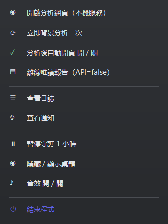

# DiskGuard · 幫你看著硬碟的小機械人

> C 盤快滿了，牠會第一時間提醒你。平時就安安靜靜坐在桌面角落，偶爾眨一下眼。

**目前版本：v1.0.1**（2026-11-25）｜想直接下載整包，看右邊的 Releases。

## 這是什麼

一個住在 Windows 桌面上的小機械人，只做一件事：**幫你盯著 C 盤還剩多少空間**。

硬碟快滿的時候，電腦會變慢、軟件裝不上、系統更新失敗——但通常你都要等到「真的出事了」才會發現。這隻小機械人就守在旁邊，等空間真的快用完，才跳出來跟你講一句。

牠不連網、不花錢、也不會偷偷動你的檔案。

## 牠平常在做什麼

| 什麼時候 | 牠在做什麼 |
|---|---|
| 一直 | 每隔幾分鐘看一眼 C 盤還剩多少空間 |
| 剩不到 2% | 跳出「磁盤剩餘空間」小窗，給你兩個選擇：**A 看清理清單**、**B 先不理** |
| 每週一次 | 挑你不忙的時候（電腦閒著）自己先算一遍，看看有什麼可以清 |
| 你點牠 | 立刻顯示目前的空間用量 |

## 清理是怎麼進行的

這是整個工具最重要的一點：**牠永遠不會自己刪東西。**

1. 空間不夠，牠跳出提醒，你按 **A**。
2. 電腦上打開一份清單，把可以清的東西分成三級：
   - **A 級**：放心刪。暫存檔、快取、日誌這種用完就沒用的東西。
   - **B 級**：看一下再決定。可能還有用，但很佔位置。
   - **C 級**：不要刪。文件、照片、程式，一律標出來提醒你別碰。
3. 清單預設只勾 A 級，任何一項你都可以自己取消。
4. 你按下確認，它才開始動手。**沒按確認，一個檔案都不會動。**
5. 動手前先幫小檔案備份；每批最多處理 10 個，做完逐個核對，最後留一份紀錄給你查。

## 牠不會做的事

- 不會自己刪任何東西——一定要你親手按確認
- 不會碰你的文件、照片、程式、遊戲存檔
- 不會清別人的回收站（其他使用者的資料不歸牠管）
- 不會上傳任何東西到網路——完全離線，不連網、不叫 AI、不花錢
- 不會在背景偷吃資源——每週那次分析會先確認電腦閒著才開始

## 怎麼開始用

1. 把整個資料夾下載到電腦上。
2. 雙擊 **`start_pet.cmd`**，小機械人就會出現在桌面右下角。
   （想低調一點、不要桌面小機械人，就雙擊 `start_guard.cmd`，只在後台守著。）
3. 想讓牠開機就自己出現：用資料夾裡「開機自動啟動」的那支設定檔跑一次就好。

不用安裝任何東西，也不用註冊帳號。

## 日常操作

| 你做什麼 | 牠會怎樣 |
|---|---|
| 左鍵點牠 | 彈出用量面板，看 C 盤還剩多少 |
| 滑鼠停在牠身上 | 身體微微放大、笑眼、嘴巴動一動，然後隨機眨幾下 |
| 拖著牠走 | 放到桌面任何位置，下次開機還在原地 |
| 右鍵點牠 | 打開功能選單 |
| 完全不理牠 | 大約每 10 秒眨一次眼，不會吵你 |

選單裡有：開分析清單、立刻分析一次、離線唯讀報告、查看日誌、查看通知、暫停守護 1 小時、隱藏桌寵、音效開關、字體大小、結束程式。

> **小提醒**：右鍵只是把選單打開，要用**左鍵**點那一項才會真的執行。按錯了想反悔，把滑鼠移開再放手就好。

## 常見問題

**看不到小機械人？**
可能被拖到螢幕外面，或者收進了右下角的托盤圖示裡。關掉重開一次就會回到原位。

**牠會不會誤刪我的東西？**
清單預設只勾「放心刪」那一級，而且一定要你按確認才動手。真的不放心，就只勾你有把握的項目，其餘留著。

**會不會拖慢電腦？**
平時幾乎不做事，只是每分鐘看一眼空間。每週那次分析也會先確認電腦閒著才開始，一旦你在用電腦就自動讓路。

**Mac 可以用嗎？**
不行，只在 Windows 上做過。

**這是正式產品嗎？**
不是。這是一個人自己用的工具，覺得有用就公開出來，給有同樣煩惱的人參考。還在慢慢打磨。

## 現在的狀態

| 功能 | 狀態 |
|---|---|
| 桌面小機械人（表情、拖曳、右鍵選單） | 已完成，日常在用 |
| 空間不足提醒 | 已完成 |
| 三級清理清單 + 確認後刪除 + 刪除紀錄 | 已完成 |
| 每週自動分析 | 已完成 |
| 開機自動啟動 | 已完成 |
| 佔用記憶體比理想高一點（約 40 MB） | 還在改善 |
| 外觀細節 | 持續調整中 |

## 關於

作者：Wahero
版本：v1.0.1（2026-11-25）｜更新內容見 [CHANGELOG](CHANGELOG.md)
授權：MIT，可自由使用、修改、轉發，保留原作者聲明即可。
