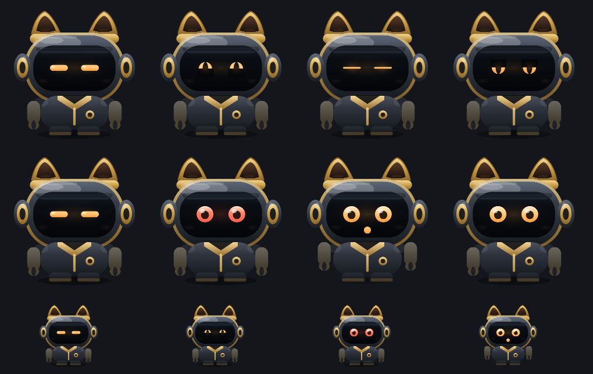

# DiskGuard · 幫你看著硬碟的小機械人

> C 盤快滿了，牠會第一時間提醒你。平時就安安靜靜坐在桌面角落，偶爾眨一下眼。

**目前版本：v1.0.3**（2026-11-25）｜想直接下載整包，看右邊的 Releases。



## 這是什麼

一個住在 Windows 桌面上的小機械人，只做一件事：**幫你盯著 C 盤還剩多少空間**。

硬碟快滿的時候，電腦會變慢、軟件裝不上、系統更新失敗——但通常你都要等到「真的出事了」才會發現。這隻小機械人就守在旁邊，等空間真的快用完，才跳出來跟你講一句。

牠不連網、不花錢、也不會偷偷動你的檔案。

## 牠平常在做什麼

| 什麼時候 | 牠在做什麼 |
|---|---|
| 一直 | 每隔幾分鐘看一眼 C 盤還剩多少空間 |
| 剩不到 2% | 跳出「磁盤剩餘空間」小窗，給你兩個選擇：**A 看清理清單**、**B 先不理** |
| 每週一次 | 挑你不忙的時候（電腦閒著）自己先算一遍，看看有什麼可以清 |
| 你點牠 | 立刻顯示目前的空間用量 |

## 清理是怎麼進行的

這是整個工具最重要的一點：**牠永遠不會自己刪東西。**

1. 空間不夠，牠跳出提醒，你按 **A**。
2. 電腦上打開一份清單，把可以清的東西分成三級：
   - **A 級**：放心刪。暫存檔、快取、日誌這種用完就沒用的東西。
   - **B 級**：看一下再決定。可能還有用，但很佔位置。
   - **C 級**：不要刪。文件、照片、程式，一律標出來提醒你別碰。
3. 清單預設只勾 A 級，任何一項你都可以自己取消。
4. 清單的六大分類**預設是收起來的**，每一類只顯示「幾項、總共多少、可以清掉多少」，你想看哪一類再點開——不會一打開就被幾百行資料淹沒。頁尾的說明（安全分級、刪除流程、上次紀錄）同樣收著，要查再看。
5. 你按下確認，它才開始動手。**沒按確認，一個檔案都不會動。**
6. 動手前先幫小檔案備份；每批最多處理 10 個，做完逐個核對，最後留一份紀錄給你查。

## 牠不會做的事

- 不會自己刪任何東西——一定要你親手按確認
- 不會碰你的文件、照片、程式、遊戲存檔
- 不會清別人的回收站（其他使用者的資料不歸牠管）
- 不會上傳任何東西到網路——完全離線，不連網、不叫 AI、不花錢
- 不會在背景偷吃資源——每週那次分析會先確認電腦閒著才開始

## 怎麼開始用

1. 把整個資料夾下載到電腦上。
2. 雙擊 **`start_pet.cmd`**，小機械人就會出現在桌面右下角。
   （想低調一點、不要桌面小機械人，就雙擊 `start_guard.cmd`，只在後台守著。）
   這兩個只能開一個。如果已經有一個在跑，雙擊另一個時會問你「要不要換成這個」——按 `y` 就換過去，直接按 Enter 就維持原狀。
3. 想讓牠開機就自己出現：用資料夾裡「開機自動啟動」的那支設定檔跑一次就好。

不用安裝任何東西，也不用註冊帳號。

## 日常操作

| 你做什麼 | 牠會怎樣 |
|---|---|
| 左鍵點牠 | 彈出用量面板，看每顆碟還剩多少 |
| 滑鼠停在牠身上 | 身體微微放大、笑眼、嘴巴動一動，然後隨機眨幾下 |
| 拖著牠走 | 放到桌面任何位置，下次開機還在原地 |
| 右鍵點牠 | 打開功能選單 |
| 完全不理牠 | 大約每 10 秒眨一次眼，不會吵你 |


右鍵選單只留四項，常用的一次點得到：
**開分析清單**、**立刻分析一次**、**系統設置**、**結束程式**。

「系統設置」往右展開第二層，設定類的東西都收在裡面：**字體大小**（再展開就是標準／大／特大，點一下就換）、**音效開關**、**隱藏桌寵**、**暫停守護 1 小時**、**查看日誌**。

按「立刻分析一次」之後，牠旁邊會出現一個小氣泡寫「**會在分析完成後開啟分析結果**」，分析跑完就自動幫你把結果網頁打開——不用再回頭點一次。（以前有個「分析後自動開頁」的開關，現在拿掉了：按了分析就是在等結果，不該還要你多按一次。）

> **小提醒**：右鍵只是把選單打開，要用**左鍵**點那一項才會真的執行。按錯了想反悔，把滑鼠移開再放手就好。
> 字體大小以前是「點一次換一級、要點三次才回到原本」，現在直接列出三級讓你挑。

## 電腦不只一顆硬碟？

**分析的時候會先問你要看哪幾顆，預設全部勾好。** 按下去之後合成**同一份清單**——不是每顆碟各一份檔案，一頁就能看完所有碟的狀況，上面的總容量、剩餘空間、可釋放量也都是加起來算的。

勾選也可以跨碟：C 盤挑幾項、D 盤挑幾項，一起按執行就好。它會一顆一顆來，每顆碟各自留一份刪除紀錄，最後再給你一份合計結果。

清單頁的頁首有一排碟別標籤（像 `C: 22.5／476 GB（4.7%）`），點一下就只看那一顆，再點「全部」回到合併檢視。只有一顆碟時這一排不會出現，版面跟以前一樣。

**監控預設只看 C 盤。** 這是刻意的：警示是為了「系統快掛了」，資料碟塞滿不會讓 Windows 出事，半夜為了一顆備份碟跳出來只會讓人想關掉它。想連別的碟一起盯，改 `cdisk-guard\config.json`：

```json
"monitor": { "drives": ["C:\\", "D:\\"] }
```

只想固定分析某幾顆、不要每次問，改 `drives`：

```json
"drives": ["C:\\"]
```

只想臨時看某一顆、不想改設定，命令列加 `--drive` 就好：

```
python scripts\cdiskctl.py --drive D: report
```

> **先說清楚**：C 盤是系統碟，能安全清的暫存與快取多，清單看起來很豐富；D、E 這種資料碟多半放你自己的檔案，能放心刪的東西少很多，清單看起來會比較「空」。那是誠實，不是沒掃到。
>
> 另外，資料碟根目錄下的整個資料夾（例如 `D:\MyData`）**不會**提供勾選——整個資料夾一鍵刪掉風險太高。真的要用，請進到裡面自己處理。

## 常見問題

**看不到小機械人？**
可能被拖到螢幕外面，或者收進了右下角的托盤圖示裡。關掉重開一次就會回到原位。

**雙擊之後視窗一閃就沒了？**
以前會這樣，而且什麼都不說——因為另一個模式正在後台跑，兩者搶同一把鎖，被擋下來的那個就默默退出了。
現在雙擊後畫面會停下來告訴你：哪一個正在跑、要不要換成你剛點的這個；真的起不來時也會把原因寫在畫面上，不會一閃就消失。
如果想知道現在到底是誰在跑，雙擊 `start_pet.cmd` 也會順帶說明（已在跑就直接講，不會重複開一份）。

**牠會不會誤刪我的東西？**
清單預設只勾「放心刪」那一級，而且一定要你按確認才動手。真的不放心，就只勾你有把握的項目，其餘留著。

**電腦有兩顆碟，會不會清到另一顆？**
不會誤清——但你可以**刻意**一起清。清單上每一列都有碟別標籤，你勾了哪幾項就只動那幾項；後端會逐項檢查路徑是不是在它自己那顆碟的允許範圍內，不是就單獨拒絕並列在結果裡。清回收站也只清那一顆（以前這一步會連別的碟一起清，v1.0.5 已修掉）。

**會不會拖慢電腦？**
平時幾乎不做事，只是每分鐘看一眼空間。每週那次分析也會先確認電腦閒著才開始，一旦你在用電腦就自動讓路。

**Mac 可以用嗎？**
不行，只在 Windows 上做過。

**這是正式產品嗎？**
不是。這是一個人自己用的工具，覺得有用就公開出來，給有同樣煩惱的人參考。還在慢慢打磨。

## 現在的狀態

| 功能 | 狀態 |
|---|---|
| 桌面小機械人（表情、拖曳、右鍵選單） | 已完成，日常在用 |
| 空間不足提醒 | 已完成 |
| 三級清理清單 + 確認後刪除 + 刪除紀錄 | 已完成 |
| 多顆硬碟（一份綜合清單、掃描前選碟、可跨碟清理） | 已完成 |
| 每週自動分析 | 已完成 |
| 開機自動啟動 | 已完成 |
| 佔用記憶體比理想高一點（約 40 MB） | 還在改善 |
| 外觀細節 | 持續調整中 |

## 關於

作者：Wahero
版本：v1.0.5（2026-11-27）｜更新內容見 [CHANGELOG](CHANGELOG.md)
授權：MIT，可自由使用、修改、轉發，保留原作者聲明即可。
